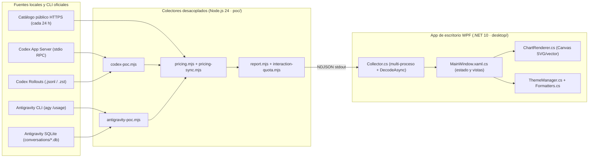

# Arquitectura

AI Usage Intelligence separa estrictamente la **recolección y análisis de datos** (sondas desacopladas en Node.js 24) de la **interfaz gráfica nativa** (WPF sobre .NET 10), comunicadas mediante un stream NDJSON por `stdin`/`stdout`.

## Módulos de recolección (`poc/`)

| Módulo | Responsabilidad |
|---|---|
| `app-server.mjs` | Cliente stdio JSON-RPC oficial de `codex app-server` (`account/read`, `account/rateLimits/read`, `project/list`, `thread/list`). |
| `rollouts.mjs` | Lector incremental de rollouts `.jsonl` y `.jsonl.zst` con caché por `mtime + size + ino` para encabezados y archivos recientes. |
| `antigravity-cli.mjs` | Invocación segura (`execFile`, sin shell) de `agy -p "/usage" --output-format json` para obtener las 4 ventanas de cuota en precisión decimal. |
| `antigravity-proto.mjs` | Decodificador Protobuf sin dependencias para `trajectory_metadata_blob`, `steps.metadata` y vista previa de mensajes. |
| `antigravity-db.mjs` | Lector SQLite de solo lectura (`node:sqlite`) con caché por archivo (`mtime + size + WAL`) y short-circuit de snapshot completo (`< 1 ms` sin cambios). |
| `pricing.mjs` / `pricing-sync.mjs` | Tarifario oficial fechado por proveedor/SKU/contexto y sincronizador HTTPS cada 24 h con validación estricta y límite de 15 MB. |
| `interaction-quota.mjs` | Correlación de lecturas de cuota con intervalos de turnos usando índice ordenado y búsqueda binaria $O(\log T)$. |
| `report.mjs` | Generación de resúmenes `24h / 7d / 30d`, desglose `Modelo × Esfuerzo`, promedios por sesión/turno y comparativa intrasesión. |

## Módulos de escritorio (`desktop/`)

- **`Collector.cs`**: administra procesos independientes por proveedor, valida límites de tamaño de línea JSON (16 MB) y decodifica en background (`Task.Run`) para mantener la UI libre de bloqueos.
- **`Models.cs`**: estado aislado por proveedor (`ProviderState`) y records inmutables de tablas/filtros.
- **`MainWindow.xaml(.cs)`**: coordinación de navegación (`Resumen`, `Preguntas`, `Análisis`, `Historial`, `Fuentes`), *debounce* de 50 ms al redimensionar y actualización perezosa del historial.
- **`ChartRenderer.cs`**: renderizado vectorial puro (barras temporales, donut de composición, barras comparativas multimétricas, filas expandibles `Modelo × Esfuerzo` y área escalonada de cuota) con brochas congeladas (`Freeze()`).
- **`ThemeManager.cs` / `Formatters.cs`**: tokens Claro/Oscuro y formateo regional.

## Almacenamiento local (fuera del repositorio)

Todos los datos generados por el usuario se guardan exclusivamente bajo `%LOCALAPPDATA%\AIUsageIntelligence\`:

- `poc/codex-*.jsonl` y `poc/antigravity-*.jsonl`: series históricas de cuota (sin prompts, sin vistas previas, sin bloque `analytics` ni rutas locales).
- `pricing-cache.json`: copia local del catálogo público de precios sincronizado cada 24 h.
- `quota-scope.key`: secreto HMAC local por usuario para seudonimizar el identificador de cuenta.
- `project-folders.json` (opcional): alias locales de carpetas movidas para Codex.
